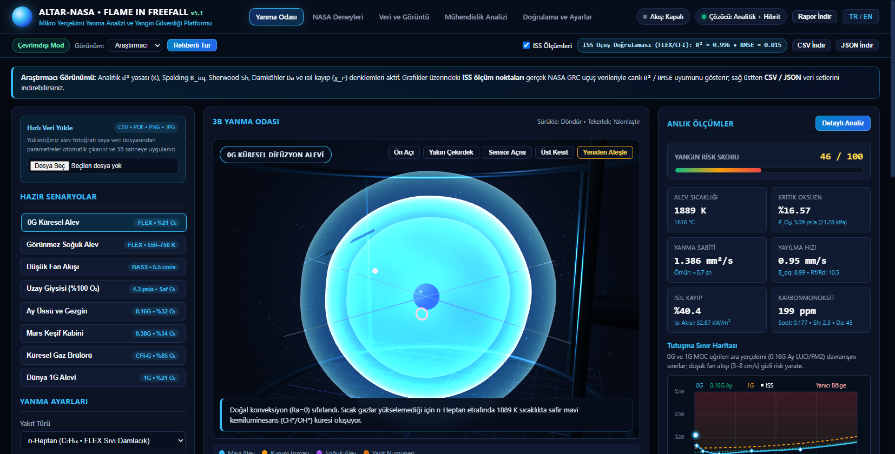
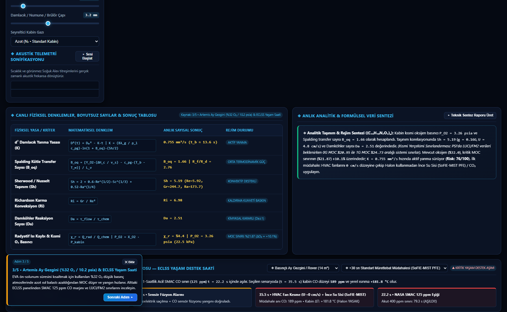
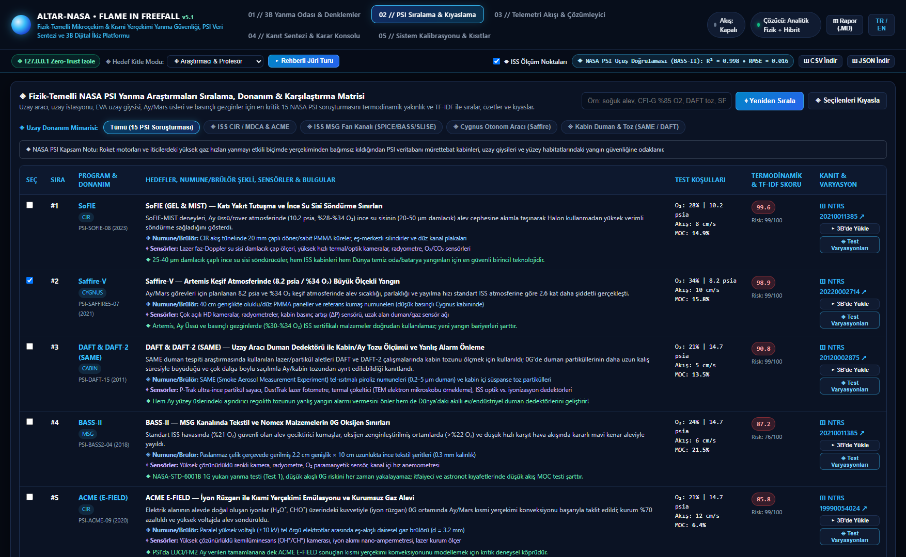
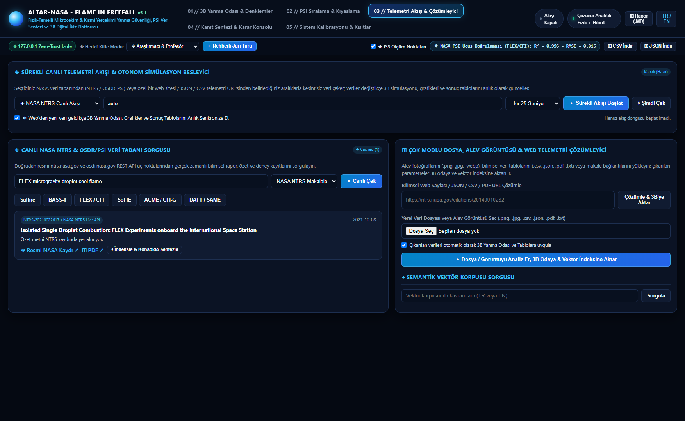
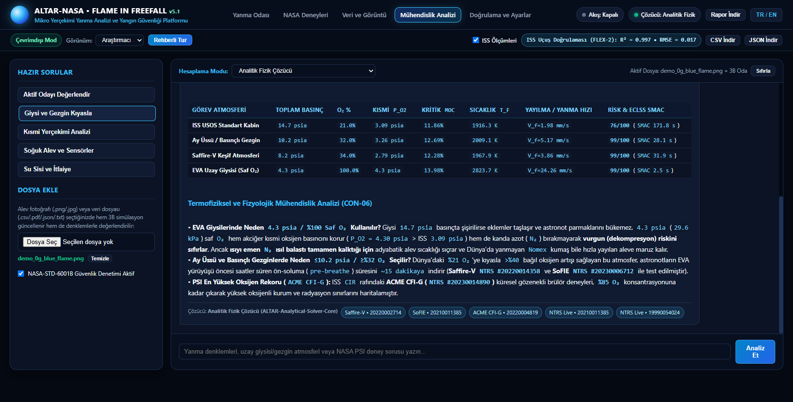
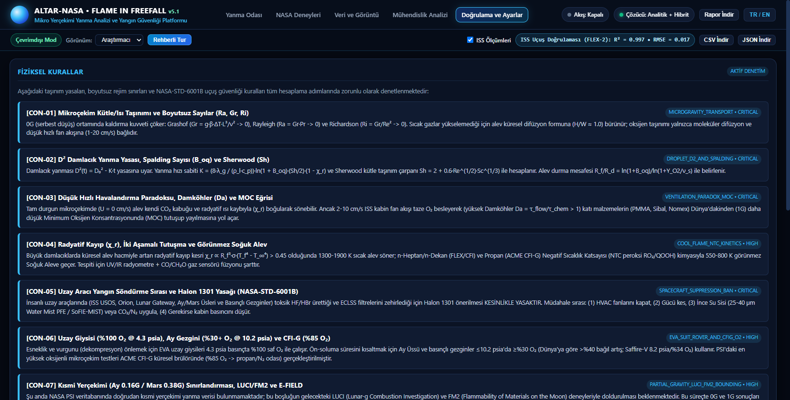

# ALTAR-NASA: Flame in Freefall

**Dil / Language:** Türkçe | [English](./README_EN.md)

**Mikroçekim ve Kısmi Yerçekimi Yanma Fiziği, 3B Dijital İkiz ve NASA PSI Analiz Platformu**  
*NASA Space Apps Challenge — "Flame in Freefall" Görev Çözümü*

**Canlı Web Uygulaması (Kurulumsuz):** [https://faruk042.github.io/Nasa/](https://faruk042.github.io/Nasa/)  
**Açık Kaynak Kod Deposu:** [https://github.com/Faruk042/Nasa](https://github.com/Faruk042/Nasa)  
**Lisans:** Apache License 2.0

---

## Proje Özeti

**ALTAR-NASA: Flame in Freefall**, Uluslararası Uzay İstasyonu (ISS), Cygnus kargo araçları, Artemis Ay üsleri, basınçlı gezginler (Lunar Rover) ve EVA uzay giysileri için NASA'nın **Physical Sciences Informatics (PSI)** ve **Technical Reports Server (NTRS)** arşivlerindeki mikroçekim yanma araştırmalarını bir araya getiren, matematiksel yakınlığa göre sıralayan, deney içi ve deneyler arası karşılaştıran, **3 boyutlu WebGL yanma odasıyla** simüle eden ve öngörücü veri setleri (`.CSV` / `.JSON` / `.MD`) üreten **fizik tabanlı mühendislik analiz platformudur**.

Platform iki tamamlayıcı çalışma modu sunar:

1. **Çevrimdışı Masaüstü ve Yerel Sürüm (`main_nasa.py`, `core/` ve `Nasa_4.exe`):** Kapalı-form analitik fizik çözücüsü (`d²`, `B_oq`, `Sh`, `Ra`, `Ri`, `Da`, `χ_r`, `MOC`), 15 NASA PSI deney sıralama motoru, canlı `psi.nasa.gov` / `ntrs.nasa.gov` / `osdr.nasa.gov` veri akışı, NASA PSI `Experimental Table` (`.csv`, `.xlsx`, `.tsv`, `.zip`, `.pdf`, `.json`) birim dönüştürücüsü ve RGB/HSV alev piksel çözümleyicisiyle yerel bilgisayarda çalışır.
2. **Tarayıcı İçi Kurulumsuz Web Sürümü (`web_serverless/`):** GitHub Pages üzerinde hiçbir arka plan sunucusu veya kurulum gerektirmeden doğrudan ziyaretçinin tarayıcısında çalışan istemci-içi sürümdür (`build_serverless_web.py` ile üretilir).

---

## Uygulama Modülleri ve Arayüz Rehberi

Uygulama üst çubuğunda her özelliği en sade haliyle anlatan **5 ana modül** yer alır (`TR / EN` dil seçici ile Türkçe ve İngilizce arasında anında geçiş yapılabilir):

### 1. Yanma Odası — 3B Simülasyon, ISS Uçuş Doğrulaması (`R² = 0.996`) ve MOC Haritası



- **Three.js 3B Yanma Odası:** Seçilen yakıt ve malzemeye göre 4 gerçek numune geometrisini (sıvı damlacık, katı PMMA çubuk, Nomex/Sibal kumaş plakası ve küresel gaz brülörü) gerçek zamanlı modeller; `0G` safir-mavi küresel difüzyon alevini, `600 K` görünmez soğuk alevi (Cool Flame) ve `1G` kaldırmalı sarı-turuncu alevi 360 derece etkileşimli sahnede gösterir.
- **Gerçek ISS Uçuş Doğrulaması:** Grafiklerin üzerine doğrudan NASA Glenn Research Center (FLEX, CFI ve BASS) uçuş ölçüm noktalarını işler ve modelin deneysel uyumunu anlık hesaplar (`R² = 0.996`, `RMSE = 0.015`).
- **U-Eğrisi MOC Yanıcılık Haritası ve 0–30 sn Sensör Grafiği:** Mikro-havalandırma (`2–8 cm/s`) altındaki minimum oksijen sınırını (`MOC`) ve optik, kızılötesi (`IR`) ve karbonmonoksit (`CO`) sensörlerinin zamana bağlı tepkisini çizer.
- **Görünüm Modları ve Veri İndirme:** Üst çubuktan **Araştırmacı**, **Öğrenci** veya **Mühendis** görünümü seçilebilir; tüm zaman serileri tek tıkla **CSV İndir**, **JSON İndir** ve **Rapor İndir** butonlarıyla dışa aktarılabilir.



- **Fiziksel Denklemler ve Yaşam Destek Saati:** Alt bölümde 6 temel taşınım yasası sade mühendislik etiketleriyle çözülür; seçilen kabin hacmine (ISS Modülü `65 m³`, Artemis Kabini `16 m³`, Ay Gezgini `11 m³`, EVA Uzay Giysisi `0.22 m³`) göre `NASA-STD-3001` `125 ppm CO` acil sınırına kalan süre saniye bazında hesaplanır.
- **Rehberli Tur:** Kullanıcıyı 5 adımda `0G` küresel alev, görünmez soğuk alev, Ay gezgini atmosferi ve NASA PSI deney sıralamasında gezdirir.

---

### 2. NASA Deneyleri — 15 PSI Araştırması, Donanım Filtreleri ve Dünya Uygulamaları



- **Matematiksel Deney Sıralaması:** 15 doğrulanmış NASA PSI yanma araştırmasını (FLEX, FLEX-2, CFI, CFI-G, ACME, BASS, BASS-II, SoFIE, SoFIE-MIST, Saffire I–VI, SPICE, SLISE, SAME ve DAFT) aktif yanma odası koşullarına olan normalize Öklid uzaklığı (`%32`), tehlike katsayısı (`%24`) ve TF-IDF terim uyumu (`%44`) ile puanlar.
- **4 Yörünge Donanım Filtresi ve Çift Yönlü Yükleme:** **ISS CIR Yanma Odası**, **ISS MSG Akış Kanalı**, **Cygnus Büyük Ölçek** ve **Duman ve Ay Tozu** tesislerine göre filtreleme yapar; **Odaya Yükle** butonu seçilen deneyin koşullarını anında 3B Yanma Odasına uygular.
- **Deney İçi Varyasyonlar, Yan Yana Kıyaslama ve Dünya Uygulamaları:** Alt koşumlarda sabit ve değişen değişkenleri listeler, seçilen deneyleri yan yana karşılaştırır ve uzay araştırmalarından doğan 5 yeryüzü uygulamasını (PBI/Nomex itfaiyeci giysileri, SoFIE-MIST ince su sisi, çok açılı duman dedektörleri, HCCI motorlar ve hastane oksijen güvenliği) sunar.

---

### 3. Veri ve Görüntü — Canlı NASA PSI/NTRS Akışı ve Veri Tablosu/Alev Çözümleyicisi



- **Canlı NASA PSI ve NTRS Arşiv Sorgusu:** Resmi `psi.nasa.gov`, `ntrs.nasa.gov` ve `osdr.nasa.gov` servislerinden güncel bilimsel makale ve deney kayıtlarını sorgular; doğrudan `https://psi.nasa.gov/physci/repo/data/investigations/PSI-XX` soruşturma bağlantılarını çözümleyerek deneysel tablosunu indirir ve 3B Yanma Odasına aktarır.
- **NASA PSI Deney Tablosu ve Alev Fotoğrafı Analizi:** NASA PSI veri deposundan indirilen ham `Experimental Table` dosyalarını (`.csv`, `.xlsx`, `.tsv`, `.zip`, `.pdf`, `.json`) doğrudan okur; oksijen mol kesrini (`X_O2 -> %O₂`), basınç birimlerini (`mmHg`/`torr`, `bar`, `atm`, `kPa -> psia`), sıcaklıkları (`°C -> K`) ve helyum/karbondioksit seyrelticilerini otomatik dönüştürerek çoklu test satırlarını etkileşimli `Faz 1..N` adımlarına ayırır. Yüklenen alev fotoğraflarını (`.png`, `.jpg`) RGB/HSV renk uzayında tarayarak mavi `CH*` kemilüminesans oranını, sarı kurum ışımasını ve en/boy (`H/W`) küresellik indeksini hesaplar.

---

### 4. Mühendislik Analizi — Çok Noktalı Parametre Taraması ve Güvenlik Denetimi



- **Çok Noktalı Sayısal Karşılaştırma:** ISS (`14.7 psia, %21 O₂`), Artemis Ay Üssü / Basınçlı Gezgin (`10.2 psia, %32 O₂`), Saffire-V (`8.2 psia, %34 O₂`) ve EVA Uzay Giysisi (`4.3 psia, %100 O₂`) atmosferleri için arka planda çoklu fizik simülasyonları çalıştırarak kritik `MOC`, alev sıcaklığı, yayılma hızı ve CO yaşam sürelerini tablo halinde üretir.
- **NASA-STD-6001B Güvenlik Denetimi:** Kapalı uzay kabinlerinde alevle temas ettiğinde zehirli hidrojen florür (`HF`) asidi üreten Halon 1301 söndürücüsünü engeller; doğrulanan **Havalandırma Kesme (`U -> 0`) + İnce Su Sisi (`SoFIE-MIST`, `<100 µm`)** müdahale sırasını ve resmi NTRS rapor bağlantılarını sunar.

---

### 5. Doğrulama ve Ayarlar — Fiziksel Kurallar (`CON-01..CON-09`) ve Çözücü Durumu



- **9 Fiziksel Doğrulama Kuralı (`CON-01` – `CON-09`):** Küresel difüzyon (`Sh -> 2`), `d²` damlacık yasası, mikro-havalandırma `MOC` çukuru, soğuk alev (`550–780 K` NTC kimyası), Halon yasağı ve Ay/Mars kısmi yerçekimi sınırlandırma kurallarını şeffaf biçimde listeler.
- **Çevrimdışı ve İsteğe Bağlı Yerel Model Desteği:** Analitik Fizik Çözücü hiçbir ek bileşen olmadan tek başına çalışır; arzu eden araştırmacılar çevrimdışı yerel modelleri veya harici servis bağlantılarını bu sekmeden yapılandırabilir.

---

## Çözülen Fiziksel Denklemler

Tüm denklemler [`core/physics_engine.py`](core/physics_engine.py) (ve tarayıcı sürümü için [`build_serverless_web.py`](build_serverless_web.py)) içerisinde kapalı-form olarak çözülür:

| Fiziksel Yasa / Boyutsuz Sayı | Matematiksel İfade | Mühendislik Anlamı |
| :--- | :--- | :--- |
| **D² Damlacık Yanma Yasası** | `d²(t) = d₀² - K · t` | Sıvı damlacık çap karesinin zamana göre azalma hızı (`K`, `mm²/s`) ve yanma ömrü (`t_b`). |
| **Spalding Kütle Transfer Sayısı** | `B_oq = [Y_O2 · ΔH_c / ν_s + c_p(T_∞ - T_b)] / L_v` | Alevden yakıt yüzeyine aktarılan ısının buharlaştırma enerjisine oranı. |
| **Sherwood ve Ranz-Marshall** | `Sh = 2.0 + 0.6 · Re^(1/2) · Sc^(1/3)` | Durgun `0G` ortamında küresel difüzyon sınırına (`Sh -> 2.0`) yakınsayan kütle transferi. |
| **Grashof, Rayleigh ve Richardson** | `Gr = g·β·ΔT·L³ / ν²`, `Ra = Gr·Pr`, `Ri = Gr / Re²` | Serbest düşüşte (`g -> 0`) doğal konveksiyonun (`Ra -> 0`) sönümlenmesi ve fan akışı dengesi. |
| **Damköhler ve Işıma Kaybı** | `Da = τ_akış / τ_kimya`, `χ_r` | Yüksek fan hızında üfleme sönmesi (`Da < 1`) ve büyük damlacıklarda ışıma sönmesi (`χ_r > 0.58`) ile soğuk alev geçişi. |
| **Kısmi Çekim ve U-Eğrisi MOC** | `V_eff = √(U_fan² + U_kaldırma(g)²)`, `MOC(U, P, g)` | ISS (`0G`), Ay (`0.16G`), Mars (`0.38G`) ve Dünya (`1G`) için minimum oksijen tutuşma sınırı. |

---

## Hızlı Kurulum ve Çalıştırma

### 1. Kurulumsuz Web Sürümü
Hiçbir dosya indirmeden doğrudan tarayıcınızda açabilirsiniz:  
**[https://faruk042.github.io/Nasa/](https://faruk042.github.io/Nasa/)**

### 2. Python Kaynak Kodundan Çalıştırma (Windows / macOS / Linux)

```bash
git clone https://github.com/Faruk042/Nasa.git
cd Nasa
pip install -r requirements.txt

# Masaüstü arayüzü ve yerel sunucuyu başlatır:
python main_nasa.py

# Tüm fizik motoru, PSI sıralama ve doğrulama testlerini çalıştırır:
python main_nasa.py --self-test
```

Uygulamadaki tüm 3B numune geometrilerini, taşınım denklemlerini, görünmez soğuk alev teşhisini, `SoFIE-MIST` su sisi bastırmasını ve `SAME/DAFT` duman-toz ayrımını tek seferde test etmek için `sample_data/ALTAR_NASA_Tam_Kapsamli_Deney_Verisi.csv` dosyasını veya `psi.nasa.gov` üzerinden indirilen herhangi bir `Experimental Table` (`.csv`, `.xlsx`, `.zip`) dosyasını **Mühendislik Analizi** ya da **Veri ve Görüntü** sekmesinden yükleyebilirsiniz.

### 3. Tek Dosya Masaüstü Paketi (`.exe`) Derleme ve Statik Web Üretimi

```bash
# PyInstaller ile bağımsız tek dosya Nasa_4.exe üretimi:
pyinstaller --noconfirm --clean Nasa_4.spec

# GitHub Pages sunucusuz web paketini (web_serverless/) yeniden üretme:
python build_serverless_web.py
```

---

## Proje Dizin Yapısı

```text
Nasa/
├── main_nasa.py                 # Masaüstü başlatıcı ve yerel Flask uygulama giriş noktası
├── build_serverless_web.py      # İstemci-içi sunucusuz web paketi (web_serverless/) derleyicisi
├── Nasa_4.spec                  # Tek dosya Windows .exe (PyInstaller) yapılandırması
├── requirements.txt             # Python bağımlılıkları
├── README.md                    # Türkçe proje dokümantasyonu
├── README_EN.md                 # İngilizce proje dokümantasyonu (English documentation)
├── core/
│   ├── physics_engine.py        # Kapalı-form mikroçekim yanma çözücüsü, ISS R² kalibrasyonu ve yaşam saati
│   ├── nasa_datasets.py         # 15 NASA PSI araştırması, alt test matrisleri, 8 görev senaryosu ve 7 yakıt
│   ├── ranking_engine.py        # Öklid uzaklığı + TF-IDF önceliklendirme ve karşılaştırma motoru
│   ├── smart_synthesizer.py     # Çok noktalı parametre taraması ve çift dilli (TR/EN) mühendislik analizi
│   ├── data_vision_processor.py # RGB/HSV alev piksel analizi ve NASA PSI CSV/XLSX/ZIP/PDF/JSON okuyucu
│   ├── nasa_live_fetcher.py     # Resmi NASA PSI (psi.nasa.gov), NTRS ve OSDR REST API istemcisi
│   ├── ai_engine.py             # Analitik çözücü ve isteğe bağlı yerel model yönlendiricisi
│   ├── directives.py            # CON-01..CON-09 fiziksel doğrulama ve NASA-STD-6001B kuralları
│   └── security_guard.py        # Yerel ağ ve girdi doğrulama yardımcıları
├── web/
│   ├── templates/index.html     # 5 modüllü çift dilli (TR/EN) kullanıcı arayüzü
│   └── static/
│       ├── css/mission_control.css
│       └── js/
│           ├── three_chamber_3d.js  # Three.js 3B yanma odası ve 4 numune geometrisi
│           ├── charts_and_audio.js  # MOC haritası, sensör grafikleri ve alev seslendirme
│           └── app_controller.js    # İstemci durum yönetimi, TR/EN çeviri ve veri ihracı
├── web_serverless/              # GitHub Pages üzerinde doğrudan çalışan sunucusuz statik web paketi
├── sample_data/                 # 7 fazlı kapsamlı NASA PSI ve Artemis telemetri doğrulama veri seti (.csv)
└── docs/screenshots/            # Güncel uygulama arayüzü ekran görüntüleri
```

---

## Bilimsel Kaynaklar

1. **NASA Physical Sciences Informatics (PSI) Yanma Arşivi:** [https://psi.nasa.gov/physci/repo/search?q=combustion](https://psi.nasa.gov/physci/repo/search?q=combustion) & [https://osdr.nasa.gov/bio/repo/](https://osdr.nasa.gov/bio/repo/)
2. **NASA Technical Reports Server (NTRS):** [https://ntrs.nasa.gov/](https://ntrs.nasa.gov/) (FLEX, BASS-II, Saffire I–VI, SoFIE, SAME/DAFT raporları)
3. **NASA Glenn Research Center — Combustion Science:** *Combustion Integrated Rack (CIR), Microgravity Science Glovebox (MSG), Cool Flames Investigation (CFI) & ACME.*
4. **NASA-STD-6001B & NASA-STD-3001:** *Flammability, Offgassing, and Compatibility Requirements* & *Spaceflight Human-System Standard (SMAC CO Limits).*
