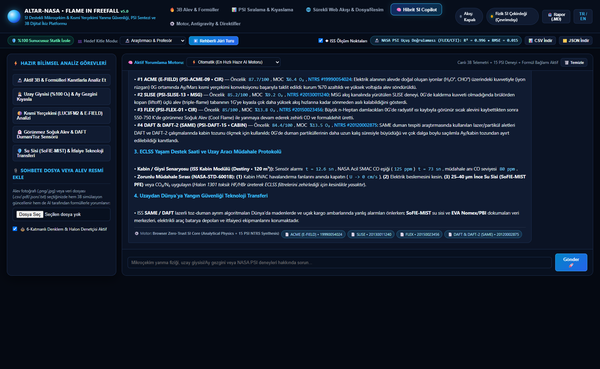
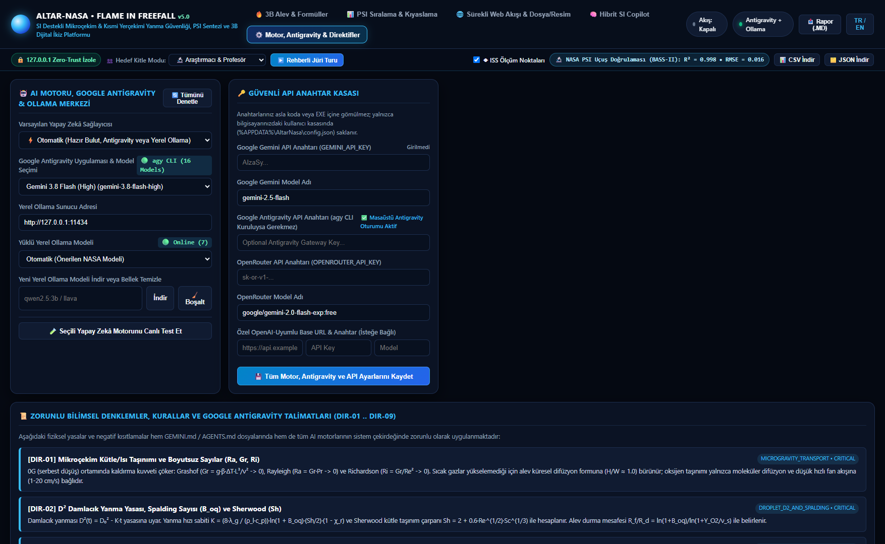
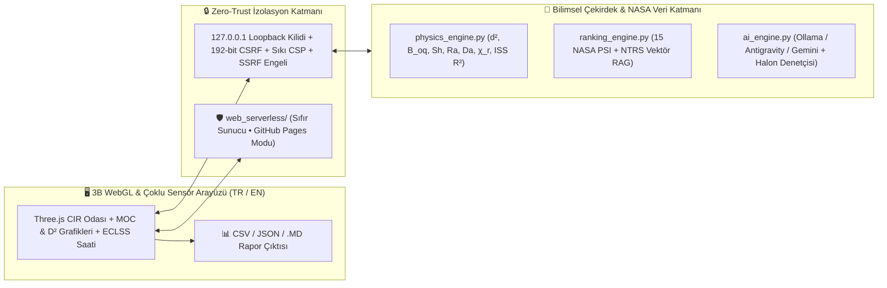

# 🚀 ALTAR-NASA • Flame in Freefall (v5.0 — Zero-Trust Global Edition)

<p align="center">
  <a href="https://faruk042.github.io/Nasa/"></a>
  <a href="./LICENSE"></a>
  
  
</p>

> **🌐 Kurulumsuz Canlı Sunucusuz Web Uygulaması (GitHub Pages):** **[https://faruk042.github.io/Nasa/](https://faruk042.github.io/Nasa/)**  
> *(Arka plan sunucusu ve açık port içermez; 3B WebGL yanma odası, termodinamik denklemler, ISS uçuş doğrulaması, ECLSS yaşam saati, 15 NASA PSI sıralama matrisi ve SI Copilot doğrudan tarayıcı belleğinde %100 izole çalışır.)*

---

## 🛰️ Proje Özeti / Executive Summary

**ALTAR-NASA: Flame in Freefall (v5.0)**, Uluslararası Uzay İstasyonu (**ISS**), **Cygnus** yörünge araçları, **Artemis** Ay üsleri, basınçlı gezginler (**Lunar Rover**) ve **EVA uzay giysileri** için NASA'nın **Physical Sciences Informatics (PSI)** ve **Technical Reports Server (NTRS)** veritabanlarındaki mikroçekim yanma araştırmalarını **özetleyen, öncelik sırasına koyan, karşılaştıran, 3 boyutlu WebGL dijital ikiziyle simüle eden ve öngörücü veri setleri üreten** hibrit Süper Zekâ (SI/AI) karar destek platformudur.

Bu depo **iki tam sürümü bir arada** barındırır:
1. **🖥️ Tam Masaüstü & Yerel/Bulut Hibrit AI Sürümü ([`main_nasa.py`](./main_nasa.py) & [`core/`](./core/)):** Yerel **Ollama** modelleri (derin uzay çevrimdışı otonomi), **Google Antigravity**, **Google Gemini API**, **OpenRouter**, canlı web kazıyıcı, çok modlu görsel/PDF işleyici ve `127.0.0.1` Zero-Trust siber güvenlik kalkanıyla çalışır; [`Nasa_3.spec`](./Nasa_3.spec) ile tek dosya `.exe` olarak derlenebilir.
2. **🌐 %100 İzole Sunucusuz Statik Web Paketi ([`web_serverless/`](./web_serverless/)):** GitHub Pages üzerinde hiçbir arka plan sunucusu olmadan doğrudan çalışan, sıkı `Content-Security-Policy (CSP)` korumalı istemci-içi sürüm ([`build_serverless_web.py`](./build_serverless_web.py) ile otomatik üretilir).

---

## 🖼️ Uygulama Arayüzü ve Özellik Rehberi / Visual Feature Walkthrough

### 1️⃣ 3B ISS CIR Yanma Odası Dijital İkizi, ISS Uçuş Doğrulaması (`R²`) ve MOC Haritası


* **3B Hacimsel WebGL Sahnesi:** `0G` safir-mavi küresel kemilüminesans (`CH*/OH*`), `0G` düşük hızlı havalandırma kuyruk alevi (`2–10 cm/s`), `550–780 K` görünmez **Soğuk Alev (Cool Flame / NTC)** ve `0.16G Ay / 0.38G Mars / 1G Dünya` kaldırma kuvvetli alev rejimlerini sıvı damlacık, katı polimer çubuk, kumaş plaka ve küresel gözenekli brülör geometrileriyle gerçek zamanlı modeller.
* **◆ Gerçek ISS Uçuş Telemetrisi Katmanı (`R²` & `RMSE`):** Sağdaki tutuşabilirlik haritası ve alttaki `0–30 sn` çoklu sensör grafiği üzerine gerçek NASA GRC (`FLEX`, `FLEX-2`, `BASS-II`, `Saffire-IV`, `ACME CFI-G`) uçuş ölçüm noktalarını hata çubuklarıyla bindirir ve canlı model uyumunu (`R² > 0.98`) doğrular.
* **👥 Hedef Kitle Modu & Öngörücü Veri Ayıklama:** Üst kontrol şeridinden *Araştırmacı & Profesör*, *Lisans Öğrencisi* veya *Uçuş Güvenlik Mühendisi* odak modları seçilebilir; tek tıkla **`.CSV`**, **`.JSON`** ve **`.MD`** bilimsel çıktılar indirilebilir.

---

### 2️⃣ Canlı Boyutsuz Denklemler, ECLSS Yaşam Destek Saati ve Rehberli Jüri Turu


* **📐 Anlık Boyutsuz Taşınım ve Termodinamik Tablosu:** Her kaydırıcı veya veri değişiminde `d²` yanma sabiti (`K`), Spalding kütle transfer sayısı (`B_oq`), Sherwood (`Sh`), Reynolds (`Re`), Grashof (`Gr`), Rayleigh (`Ra`), Richardson (`Ri`), Damköhler (`Da`) ve radyatif kayıp kesri (`χ_r`) anında yeniden hesaplanır.
* **⏱️ ECLSS Mürettebat Yaşam Destek Saati:** `ISS Modülü (120 m³)`, `Artemis Ay Üssü (45 m³)`, `Basınçlı Ay Gezgini (14 m³)` ve `EVA Uzay Giysisi (0.18 m³ • 4.3 psia %100 O₂)` hacimlerinde sensör alarm anını, NASA 1-Saatlik Acil **`125 ppm CO SMAC`** zehirlilik süresini ve `+10 sn / +30 sn / +60 sn` müdahale gecikmelerindeki kabin ısınmasını (`ΔT`) simüle eder.
* **🌗 Kısmi Yerçekimi (`LUCI` & `FM2`) Şeffaflığı:** Ay (`0.16G`) ve Mars (`0.38G`) seçimlerinde NASA PSI'daki mevcut veri boşluğunu şeffafça bildirir ve `0G–1G` MOC sınırlandırma eğrileriyle güvenli zarfı çizer.

---

### 3️⃣ 15 NASA PSI Soruşturması Sıralama Matrisi, Donanım Rafları ve Dünya'ya Teknoloji Transferi


* **🛠️ Uzay Donanım Raf Filtresi:** **ISS CIR / MDCA & ACME**, **ISS MSG Fan Akış Kanalı** (`SPICE`, `BASS`, `SLISE`), **Cygnus Otonom Aracı** (`Saffire I/IV/V`) ve **Kabin & DAFT** (lazerli duman vs. Ay tozu ayrımı) donanımlarını tek tıkla filtreler.
* **🔬 Soruşturma İçi Test Varyasyonları (`Intra-Run Matrix`):** Aynı NASA deneyi içindeki farklı test koşullarının (*sabit tutulan vs. değiştirilen parametreler ve sonuçları*) yan yana analizini ve **Uzaydan Dünya'ya 5 yangın güvenliği transferini** (itfaiyeci PBI/Nomex giysileri, SCBA tüpleri, EV batarya ince su sisi, akıllı toz-ayrımlı duman dedektörleri) sunar.

---

### 4️⃣ Sürekli Canlı NASA NTRS/OSDR Web Akışı, Görsel/Dosya İşleyici ve Vektör RAG


* **🔄 Otonom Canlı Veri Akışı:** Resmi `NASA NTRS` ve `NASA OSDR/PSI` uç noktalarından periyodik veri çekerek çıkarılan oksijen, basınç ve akış hızlarını doğrudan 3B yanma odasına ve formül tablolarına senkronize eder.
* **🖼️ Çok Modlu Alev Fotoğrafı & Veri Dosyası Çözümleyici:** Yüklenen `.png/.jpg` alev görsellerinden kemilüminesans/kurum/soğuk-alev spektrumunu; `.csv/.pdf/.json/.txt` belgelerinden ise deney parametrelerini çıkarıp TF-IDF kosinüs benzerlikli RAG hafızasına indeksler.

---

### 5️⃣ Hibrit SI Copilot: Kanıt İzlenebilir Bilimsel Sentez ve `NASA-STD-6001B` Halon Denetçisi


* **🧠 Nöro-Sembolik Karar Destek:** Aktif 3B simülasyon telemetrisini, boyutsuz denklemleri ve en alakalı NASA PSI makalelerini birleştirerek tıklanabilir **NTRS kaynak rozetleriyle** yanıt üretir.
* **🛡️ Zorunlu Halon 1301 Yasağı:** Toksik `HF/HBr` gazlarıyla ECLSS yaşam destek filtrelerini zehirleyen Halon 1301 önerilerini 6-katmanlı denetçiyle engeller; daima **(1) HVAC Fan Kesme (`U → 0 cm/s`) → (2) Güç İzolasyonu → (3) `25–40 µm` İnce Su Sisi (`SoFIE-MIST`) / `CO₂`** protokolünü uygular.

---

### 6️⃣ Hibrit AI Motor Yönetimi (Yerel Ollama • Antigravity • Gemini) ve Bilimsel Direktifler


* **🔌 Çoklu Motor Mimarisi:** Derin uzay iletişim gecikmelerine uygun **%100 çevrimdışı Yerel Ollama** modelleri, masaüstü **Google Antigravity (`agy` CLI)**, **Google Gemini API**, **OpenRouter** ve internet yokken bile kesintisiz çalışan **Yerleşik Deterministik Fizik SI Çekirdeği** tek merkezden yönetilir ve canlı gecikme testiyle doğrulanır.

---

## 🏗️ Sistem Mimarisi ve Siber Güvenlik Kalkanı / Zero-Trust Architecture



* **%100 Ağ İzolasyonu ([`core/security_guard.py`](./core/security_guard.py)):** Masaüstü sunucusu yalnızca `127.0.0.1` arayüzüne bağlanır (`0.0.0.0` kapalıdır). Wildcard CORS kaldırılmıştır; DNS-Rebinding (`Host` doğrulaması), yabancı sekme istekleri (`Origin` + `Sec-Fetch-Site`), CSRF (`X-Altar-CSRF`) ve özel IP SSRF yönlendirmeleri `HTTP 403/400` ile engellenir.
* **Sıfır Gömülü Anahtar:** Depoda veya statik web paketinde hiçbir API anahtarı ya da kişisel veri bulunmaz.

---

## 📐 Çözülen Temel Fiziksel Denklemler / Governing Equations

| Fiziksel Yasa / Boyutsuz Sayı | Matematiksel İfade | Uzay Yangın Güvenliği Karşılığı |
| :--- | :--- | :--- |
| **$d^2$ Damlacık Yanma Yasası** | $D^2(t) = D_0^2 - K \cdot t$, $\; K = \frac{8 \lambda_g}{\rho_l c_{p,g}} \ln(1 + B_{oq}) \frac{Sh}{2}(1 - \chi_r)$ | Sıvı yakıt damlacığı yanma hızı ve ömrü (`FLEX` / `FLEX-2`) |
| **Spalding Kütle Transfer Sayısı** | $B_{oq} = \frac{Y_{O_2}(\Delta H_c / \nu_s) - c_{p,g}(T_b - T_\infty)}{L_v}$ | Termodinamik kütle transfer sürücü potansiyeli |
| **Sherwood & Rayleigh Taşınımı** | $Sh = 2 + 0.6 Re^{1/2} Sc^{1/3} + 0.52 Ra^{1/4}$ | `0G`'de ($Ra \to 0$) saf moleküler difüzyon ($Sh \to 2$) limiti |
| **Damköhler Reaksiyon Sayısı** | $Da = \tau_{\text{flow}} / \tau_{\text{chem}}$ | Yüksek fan akışında üfleme sönmesi ($Da < 1$) vs. mikro-havalandırma riski |
| **Radyatif Kayıp & Soğuk Alev** | $\chi_r = Q_{\text{rad}} / Q_{\text{chem}}$ | Kritik $\chi_r$ aşımında sıcak alevin sönüp `550–780 K` görünmez Soğuk Aleve geçişi |
| **Kısmi Oksijen Basıncı** | $P_{O_2} = X_{O_2} \cdot P_{\text{kabin}}$ | EVA uzay giysisi (`4.3 psia / %100 O₂`) ve Ay gezgini (`10.2 psia / %32 O₂`) analizi |

---

## ⚡ Kurulum ve Çalıştırma / Quick Start

### Seçenek A: Kurulumsuz Sunucusuz Web Sürümü (GitHub Pages)
Tarayıcınızdan doğrudan açın: **[https://faruk042.github.io/Nasa/](https://faruk042.github.io/Nasa/)**  
*(veya yerel olarak [`web_serverless/`](./web_serverless/) dizinini herhangi bir statik barındırma servisine yükleyin).*

### Seçenek B: Tam Masaüstü ve Hibrit AI Sürümü (Python / Tek Dosya `.EXE`)
```bash
git clone https://github.com/Faruk042/Nasa.git
cd Nasa
pip install -r requirements.txt

# Zero-Trust güvenlik ve bilimsel doğrulama öz-testi:
python main_nasa.py --self-test

# 3B Görev Kontrol Panelini başlat:
python main_nasa.py
```

* **Sunucusuz Statik Paketi Yeniden Üretmek İçin:** `python build_serverless_web.py`
* **Tek Dosya Bağımsız `Nasa_3.exe` Derlemek İçin:** `pyinstaller --noconfirm --clean Nasa_3.spec`

---

## 📚 Resmi NASA Veri Kaynakları / Official Open-Science References
* **NASA Physical Sciences Informatics (PSI):** `FLEX`, `FLEX-2`, `CFI`, `ACME (E-FIELD, BRE, CFI-G)`, `SoFIE (GEL & MIST)`, `BASS`, `BASS-II`, `SPICE`, `SLISE`, `Saffire (I–VI)`, `SAME / DAFT / DAFT-2`
* **NASA Technical Reports Server (NTRS):** Doğrudan API entegrasyonu ve doğrulanmış atıf bağlantıları (`https://ntrs.nasa.gov`)
* **NASA Open Science Data Repository (OSDR)** & **NASA-STD-6001B** *(Flammability, Offgassing, and Compatibility Requirements)*

---

## 📄 Lisans / License

Bu proje **Apache License 2.0** kapsamında lisanslanmıştır — tüm detaylar için [`LICENSE`](./LICENSE) dosyasına bakınız.  
Copyright © 2026 **Faruk Emir Bilgin**.
