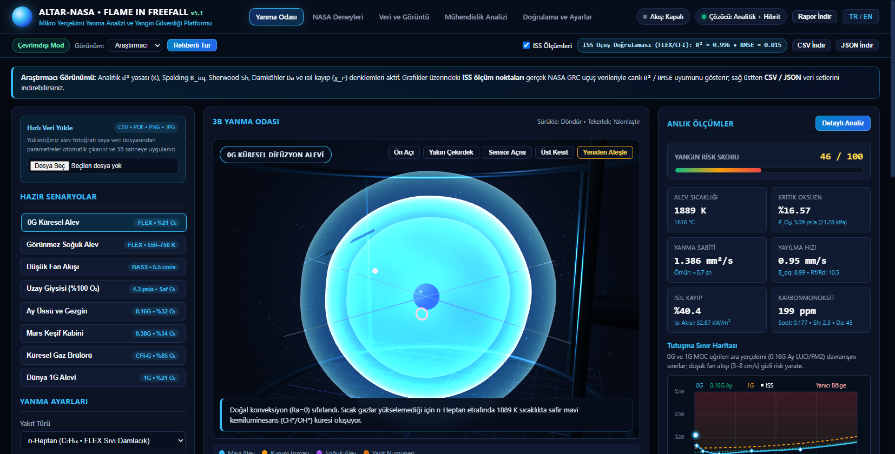
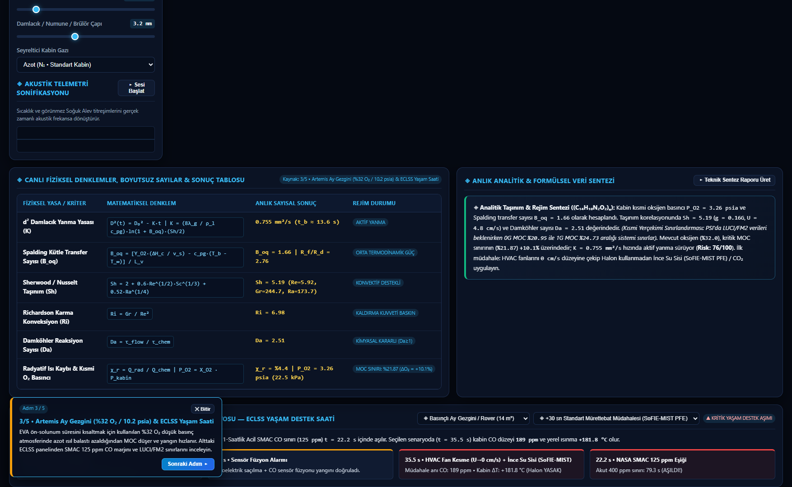
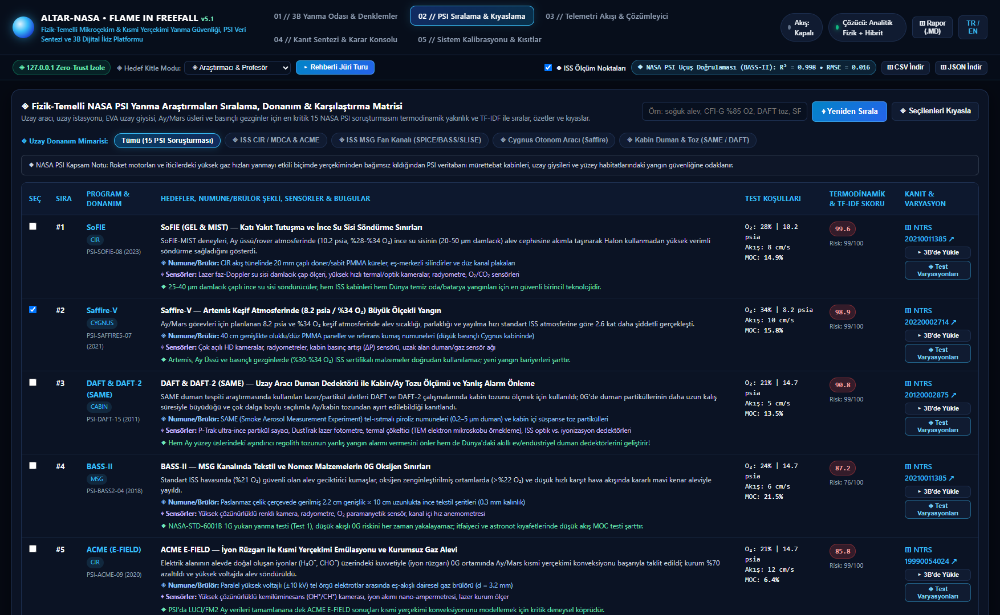
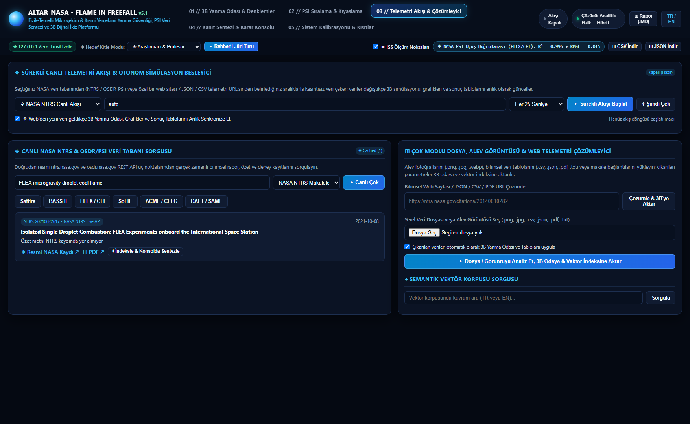
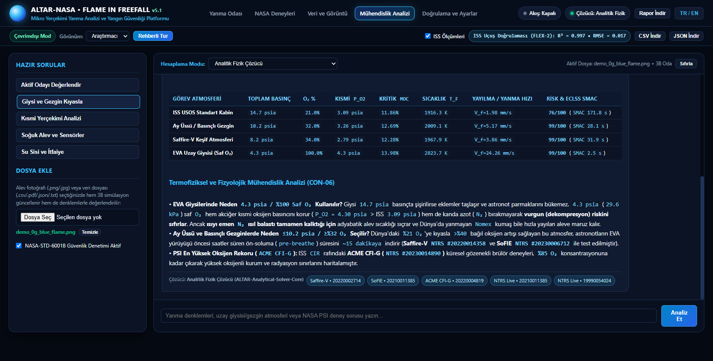
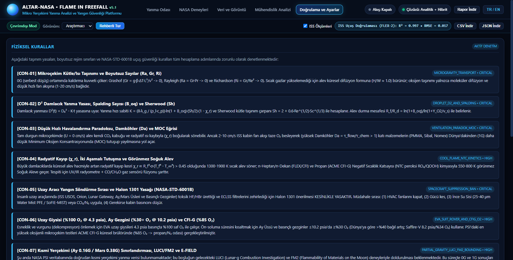

# ALTAR-NASA: Flame in Freefall

**Language / Dil:** English | [Türkçe](./README.md)

**Microgravity & Partial-Gravity Combustion Physics, 3D Digital Twin & NASA PSI Analysis Platform**  
*NASA Space Apps Challenge — "Flame in Freefall" Engineering Solution*

**Live Web Application (No Installation):** [https://faruk042.github.io/Nasa/](https://faruk042.github.io/Nasa/)  
**Open-Source Repository:** [https://github.com/Faruk042/Nasa](https://github.com/Faruk042/Nasa)  
**License:** Apache License 2.0

---

## Executive Summary

**ALTAR-NASA: Flame in Freefall** is a physics-based combustion engineering and decision-support platform built on NASA's **Physical Sciences Informatics (PSI)** and **Technical Reports Server (NTRS)** archives. Designed for the International Space Station (ISS), Cygnus spacecraft, Artemis Lunar habitats, pressurized rovers, and EVA spacesuits, it ranks orbital combustion experiments by mathematical proximity, compares intra-run and cross-investigation findings, simulates flames inside an interactive **3D WebGL combustion chamber**, and exports predictive datasets (`.CSV` / `.JSON` / `.MD`).

The repository includes two complete runtime modes:

1. **Offline Desktop & Local Python Edition (`main_nasa.py`, `core/`, and `Nasa_4.exe`):** Runs the phase-specific closed-form analytical transport solver (`d²` droplet, `de Ris` solid spread, `Burke-Schumann` steady gas burner, `B_oq`, `Sh`, `Ra`, `Ri`, `Da`, `χ_r`, `MOC`), 15-experiment NASA PSI ranking engine, live `psi.nasa.gov` / `ntrs.nasa.gov` / `osdr.nasa.gov` telemetry stream, native NASA PSI `Experimental Table` (`.csv`, `.xlsx`, `.tsv`, `.zip`, `.pdf`, `.json`) unit normalizer, and RGB/HSV flame image analyzer locally without requiring cloud connectivity.
2. **Browser-Native Serverless Web Edition (`web_serverless/`):** Runs directly inside any modern browser on GitHub Pages with zero backend servers or installation (`build_serverless_web.py`).

---

## Application Modules & Interface Walkthrough

The interface is organized into **5 clear modules** with instant **TR / EN** bilingual switching in the top bar:

### 1. Combustion Chamber — 3D Digital Twin, ISS Flight Validation (`R² = 0.996`) & MOC Map



- **Three.js 3D Combustion Chamber:** Dynamically renders 4 physical specimen geometries based on the selected material (liquid droplet on quartz fiber, solid PMMA rod, Nomex/Sibal fabric sheet, and porous spherical gas burner) across `0G` sapphire spherical diffusion flames, `600 K` invisible cool flames, and `1G` buoyant plumes.
- **Published ISS 0G Reference Validation:** Overlays published NASA Glenn Research Center `0G` benchmark curves (`FLEX`, `CFI`, `BASS`, and `ACME`) directly onto the live charts and computes goodness-of-fit (`R²`, `RMSE`).
- **U-Shaped MOC Flammability Map & 0–30 s Multi-Sensor Chart:** Solves the micro-ventilation Minimum Oxygen Concentration (`MOC`) curve (`2–8 cm/s` danger trough) alongside optical, infrared (`IR`), and carbon monoxide (`CO`) sensor traces.
- **Audience Views & Predictive Data Export:** Switch between **Researcher**, **Student**, and **Engineer** views, and download full time-series and validation metrics via **Download CSV**, **Download JSON**, and **Download Report**.



- **Governing Equations & ECLSS Life Support Clock:** Displays 6 phase-aware dimensionless transport equations and computes exact countdowns (in seconds) using the Ideal Gas Law and 1st Law (`Q = m_gas · c_p · ΔT`) for **ISS Photoelectric Smoke Detector (`PSD`) + `CSA-CP / ANITA-2`** alarm activation and official **`NASA JSC-20584` CO SMAC** limits (`25 ppm` mask / `100 ppm` 24-hr / `425 ppm` 1-hr) across 4 free-air cabin volumes (ISS Destiny Module `70 m³`, Orion / Gateway Cabin `19 m³`, Pressurized Lunar Rover `11 m³`, and EVA Spacesuit `0.18 m³`).
- **Guided Tour:** Walks judges, students, and researchers through 5 interactive mission scenarios step by step.

---

### 2. NASA Experiments — 15 PSI Investigations, Hardware Filters & Earth Applications



- **Mathematical Experiment Ranking:** Scores 15 verified NASA PSI investigations (FLEX, FLEX-2, CFI, CFI-G, ACME, BASS, BASS-II, SoFIE, SoFIE-MIST, Saffire I–VI, SPICE, SLICE, SAME, and DAFT) by combining normalized Euclidean parameter distance (`32%`), fire hazard weight (`24%`), and TF-IDF term similarity (`44%`).
- **4 Orbital Hardware Filters & Two-Way Chamber Sync:** Filter by **ISS CIR Chamber**, **ISS MSG Flow Duct**, **Cygnus Large-Scale**, and **Smoke & Lunar Dust**; click **Load in 3D** on any row to apply that flight experiment's exact boundary conditions to the 3D chamber.
- **Test Variations, Cross-Experiment Comparison & Earth Applications:** Inspect held-constant vs. varied parameters within individual ISS test runs, compare multiple investigations side by side, and explore 5 verified terrestrial spin-offs (PBI/Nomex firefighter gear, SoFIE-MIST water-mist suppression for EV batteries and data centers, multi-angle smoke detectors, HCCI engines, and hospital oxygen safety).

---

### 3. Data & Imagery — Live NASA PSI/NTRS Stream & Dataset/Flame Analysis



- **Live NASA PSI & NTRS Archive Search:** Queries official `psi.nasa.gov`, `ntrs.nasa.gov`, and `osdr.nasa.gov` REST APIs for microgravity combustion papers and datasets, and directly resolves both search URLs (`https://psi.nasa.gov/physci/repo/search?q=combustion` via an interactive 36-investigation picker) and individual `https://psi.nasa.gov/physci/repo/data/investigations/PSI-XX` URLs into multi-phase 3D chamber runs.
- **NASA PSI Experimental Table & Flame Analysis:** Directly parses raw NASA PSI `Experimental Table` files across `.csv`, `.xlsx`, `.tsv`, `.zip`, `.pdf`, and `.json` formats — automatically converting oxygen mole fractions (`X_O2 -> %O₂`), pressure units (`mmHg`/`torr`, `bar`, `atm`, `kPa -> psia`), temperatures (`°C -> K`), and helium/carbon-dioxide diluents while grouping multi-run matrices into interactive `Phase 1..N` chamber presets. Also analyzes uploaded flame photographs (`.png`, `.jpg`) pixel-by-pixel in RGB/HSV space to quantify blue `CH*` chemiluminescence vs. yellow soot incandescence and aspect-ratio (`H/W`) sphericity.

---

### 4. Engineering Analysis — Multi-Point Parameter Sweeps & Safety Auditing



- **Multi-Point Analytical Sweeps:** Runs background parameter sweeps across ISS (`14.7 psia, 21% O₂`), Artemis Lunar Base / Pressurized Rover (`10.2 psia, 32% O₂`), Saffire-V (`8.2 psia, 34% O₂`), and EVA Spacesuit (`4.3 psia, 100% O₂`) atmospheres to generate structured comparison tables of critical `MOC`, flame temperature, spread rate, and CO survival margins.
- **NASA-STD-6001B Safety Check:** Enforces spacecraft fire-suppression rules — rejecting Halon 1301 in sealed cabins due to toxic hydrogen fluoride (`HF`) formation and recommending **Ventilation Shutoff (`U -> 0`) + Fine Water Mist (`SoFIE-MIST`, `<100 µm`)** with clickable NTRS report citations.

---

### 5. Validation & Settings — Physical Rules (`CON-01..CON-09`) & Solver Status



- **9 Physical Validation Rules (`CON-01` – `CON-09`):** Documents the enforced transport laws, including spherical diffusion (`Sh -> 2`), phase-specific `d²` / `de Ris` / `Burke-Schumann` kinetics, micro-ventilation `MOC` minimums, cool-flame (`550–780 K` NTC chemistry), Halon prohibition, and Lunar/Martian partial-gravity bounding prior to upcoming LUCI and FM2 missions.
- **Standalone Solver & Optional Local Model Settings:** The Analytical Physics Solver operates completely standalone offline; optional local models or external gateways can also be configured from this tab.

---

## Governing Transport Equations

All equations are solved in closed form in [`core/physics_engine.py`](core/physics_engine.py) (and mirrored for client-side browser execution in [`build_serverless_web.py`](build_serverless_web.py)):

| Physical Law / Dimensionless Group | Formulation | Engineering Role |
| :--- | :--- | :--- |
| **Phase-Specific Combustion Law (`d²` / `de Ris` / `Burke-Schumann`)** | Liquid: `d²(t) = d₀² - K·t` • Solid: `V_f ~ λ_g·(T_f - T_vap)/(ρ_s·c_s·δ_g·(T_vap - T_∞))` • Gas: `D_burner = D₀` | Droplet area regression (`K`), opposing-flow solid flame spread (`V_f`), and steady-feed porous/jet gas diffusion flames. |
| **Spalding Mass / Phase Transfer Number** | Liquid/Solid: `B_oq = [Y_O2·ΔH_c/ν_s + c_p(T_∞ - T_b)] / L_v` • Gas: `B_g = ... / Δh_sens` | Ratio of flame thermal feedback to phase-change enthalpy (`L_v`) or gas sensible enthalpy (`Δh_sens`). |
| **Sherwood & Ranz-Marshall** | `Sh = 2.0 + 0.6 · Re^(1/2) · Sc^(1/3)` | Convective-diffusive mass transfer converging to pure spherical diffusion (`Sh -> 2.0`) in quiescent `0G`. |
| **Grashof, Rayleigh & Richardson** | `Gr = g·β·ΔT·L³ / ν²`, `Ra = Gr·Pr`, `Ri = Gr / Re²` | Collapse of buoyant convection (`Ra -> 0`) in freefall and buoyancy-to-ventilation ratio. |
| **Damköhler & Radiative Loss** | `Da = τ_flow / τ_chem`, `χ_r` | High-airflow blowoff (`Da < 1`) vs. radiative quenching (`χ_r > 0.58`) into `600 K` cool flames. |
| **Partial-Gravity & U-Curve MOC** | `V_eff = √(U_fan² + U_buoy(g)²)`, `MOC(U, P, g)` | Minimum Oxygen Concentration boundary across ISS (`0G`), Moon (`0.16G`), Mars (`0.38G`), and Earth (`1G`). |

---

## Quick Start & Build Instructions

### 1. Instant Browser Access (Zero Setup)
Open directly in any browser:  
**[https://faruk042.github.io/Nasa/](https://faruk042.github.io/Nasa/)**

### 2. One-Click Zero-Prerequisite Setup & `.exe` Builder (Clean Windows 10/11)

On a brand-new Windows 10/11 PC with nothing pre-installed, download the repository via **Code -> Download ZIP**, extract the folder, and double-click either launcher (all runtimes install cleanly inside `Nasa/.runtime/` without polluting system directories):

- **`Nasa_Hemen_Calistir.bat`:** Automatically provisions folder-local Python 3.12, virtual environment dependencies, and portable `Ollama` (`qwen3.5:4b`), then launches the desktop suite.
- **`Nasa_EXE_Olustur.bat`:** Automatically provisions the full build toolchain inside `Nasa/.runtime/`, runs `--self-test`, and compiles the standalone single-file **`Nasa_4.exe`** directly into the project root.

### 3. Run Manually from Python Source (Windows / macOS / Linux)

```bash
git clone https://github.com/Faruk042/Nasa.git
cd Nasa
pip install -r requirements.txt

# Launch the desktop launcher and local web interface:
python main_nasa.py

# Run the automated physics, ranking, and validation test suite:
python main_nasa.py --self-test
```

To test all simulation geometries, governing equations, cool-flame diagnostics, `SoFIE-MIST` suppression, and `SAME/DAFT` aerosol discrimination in a single file upload, attach `sample_data/ALTAR_NASA_Tam_Kapsamli_Deney_Verisi.csv` or any official `Experimental Table` (`.csv`, `.xlsx`, `.zip`) downloaded from `psi.nasa.gov` inside the **Engineering Analysis** or **Data & Imagery** module.

### 4. Manual CLI `.exe` Compilation & Serverless Static Web Bundle

```bash
# Compile single-file Windows executable (dist/Nasa_4.exe):
pyinstaller --noconfirm --clean Nasa_4.spec

# Rebuild the GitHub Pages serverless static web bundle (web_serverless/):
python build_serverless_web.py
```

---

## Primary NASA References

1. **NASA Physical Sciences Informatics (PSI) Combustion Repository:** [https://psi.nasa.gov/physci/repo/search?q=combustion](https://psi.nasa.gov/physci/repo/search?q=combustion) & [https://osdr.nasa.gov/bio/repo/](https://osdr.nasa.gov/bio/repo/)
2. **NASA Technical Reports Server (NTRS):** [https://ntrs.nasa.gov/](https://ntrs.nasa.gov/) (FLEX, BASS-II, Saffire I–VI, SoFIE, SAME/DAFT reports)
3. **NASA Glenn Research Center — Combustion Science:** *Combustion Integrated Rack (CIR), Microgravity Science Glovebox (MSG), Cool Flames Investigation (CFI) & ACME.*
4. **NASA-STD-6001B, NASA-STD-3001 & NASA JSC-20584:** *Flammability, Offgassing, and Compatibility Requirements*, *Spaceflight Human-System Standard* & *Spacecraft Maximum Allowable Concentrations (CO SMAC: 25 / 100 / 425 ppm).*
